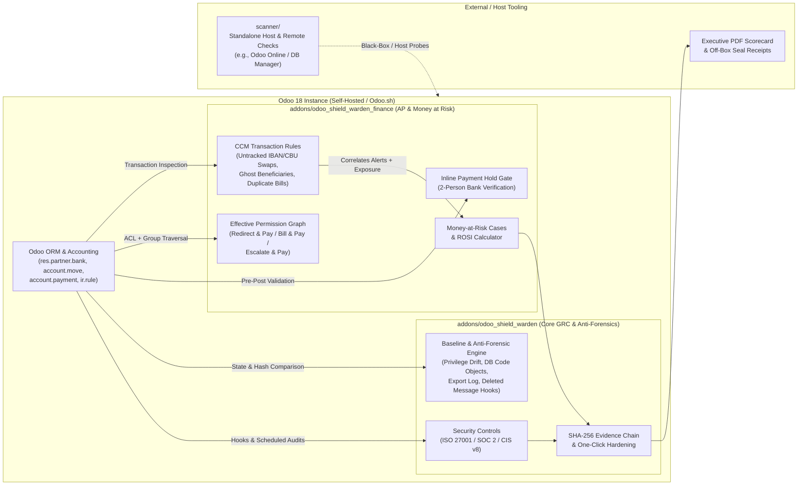

# Odoo Shield Warden — "Money at Risk" Controls & Continuous GRC Monitoring for Odoo 18

> **Edition:** Portfolio edition of the Shield concept (open-source reference & controls engine for Odoo 18 Self-Hosted / Odoo.sh).  
> **Commercial edition:** available on request  
> **Focus:** Continuous Controls Monitoring (CCM), Accounts Payable Fraud Prevention, and Cryptographic Audit Integrity

---

## 1. The Problem: ERP Controls Blind Spots & "Money at Risk"

Organizations running Odoo 18 rely on standard role-based access controls (`res.groups`) and basic chatter logs (`mail.thread`) to protect Accounts Payable (AP) and core system configuration. In practice, three systemic blind spots expose capital directly to insider fraud and credential compromise:

1. **Silent Audit-Trail Bypass in Accounts Payable:** Any user or API caller with write access to vendor bank accounts (`res.partner.bank`) or invoices can pass `context={'tracking_disable': True}` via XML-RPC/JSON-RPC—or alter records via direct SQL/scheduled actions—swapping a vendor's IBAN/CBU/CVU before a payment run while leaving the Odoo chatter completely blank.
2. **Toxic Combinations of Effective Privileges (SoD Drift):** Odoo permissions accumulate across inherited groups. Standard permission matrices rarely translate raw ACLs and record rules into concrete financial attack paths—such as **Redirect & Pay** (modify vendor bank + post payment), **Escalate & Pay** (grant self rights + pay), or **Bill & Pay** (create vendor bill + approve/pay).
3. **Configuration & Anti-Forensic Tampering:** Native Odoo maintains no built-in export audit log, no baseline diffing for privilege escalation, and no tamper-evident seal on historical compliance checks. An attacker or rogue insider with `Settings` access can inject server actions (`ir.actions.server`), hide transactions from auditors via custom record rules (`ir.rule`), and delete chatter messages (`mail.message`).

---

## 2. The Approach: Quantified "Money at Risk" & Enforced Payment Holds

**Odoo Shield Warden** (the portfolio edition of the Shield concept) shifts ERP security from static checklists to **financial exposure quantification ("Money at Risk")** and **inline preventive controls**:

- **Automated Security & GRC Controls (`odoo_shield_warden`):** Continuous assessment of **42 automated controls** mapped against **ISO 27001**, **SOC 2**, and **CIS Controls v8**, covering authentication hardening (MFA coverage, login throttling, default admin checks), database/environment exposure (`dbmanager_exposed`, weak DB credentials), anti-forensics (`db_code_objects`, custom `ir.rule` inspection, privilege drift against a sealed baseline), mass data exports, and static scanning of third-party addons.
- **Preventive Payment Hold (`odoo_shield_warden_finance`):** Automatically intercepts payments (`account.payment`) directed to newly created or recently modified vendor bank accounts (IBAN, CBU, CVU) and enforces **second-person verification** before funds can be released (`shield.payment_hold = enforce`).
- **Continuous Controls Monitoring (CCM) Transaction Rules & Case Grouping:** Runs **8 continuous transaction monitoring rules** plus **3 effective-permission Segregation of Duties (SoD) rules** (`Redirect & Pay`, `Escalate & Pay`, `Bill & Pay`). Detects untracked bank swaps (comparing chatter logs, `write_date`, and independent SHA-256 bank fingerprints), shared bank accounts between vendors and staff contacts ("ghost beneficiaries"), self-approved/self-paid bills, duplicate vendor bills, and rapid new-vendor payouts. Related alerts are correlated into investigation **Cases** with aggregated **Money at Risk** totals ($54,800 across 5 cases from 15 alerts in the lab benchmark) and a built-in **ROSI (Return on Security Investment)** model.
- **Tamper-Evident Evidence Chain:** Every assessment and control attestation is linked into a **SHA-256 hash chain** with optional off-box seal receipts and an executive PDF scorecard.
- **Lab-Validated Detection Coverage:** Validated against a local, synthetic adversarial fraud and anti-forensics benchmark (`lab/attack_lab.py` and `lab/kaizen_loop.py`), advancing detection from **3/14 scenarios in baseline to 14/14 in Cycle 2, 18/18 in Cycle 3, and 22/22 scenarios (+ 2/2 inline preventions and 60 unit tests)** in Cycle 4 across Odoo 18 and 19.

---

## 3. Architecture



### Repository Layout

| Path | Description |
| :--- | :--- |
| `addons/odoo_shield_warden` | Core GRC & security module: automated controls, anti-forensic monitors (DB-stored code, custom record rules, privilege drift, export & deleted-message logging), static third-party addon scanner, risk register, one-click hardening, SHA-256 evidence chain, and PDF scorecard. |
| `addons/odoo_shield_warden_finance` | Accounting controls pack (auto-installs with `account`): enforced two-person payment hold on unverified bank details (IBAN/CBU/CVU), toxic-privilege detection, CCM transaction fraud rules, Money-at-Risk case aggregation, and ROSI view. |
| `scanner/` | Standalone external/host inspection scripts for environments where custom addons cannot be installed (such as Odoo Online). |
| `tools/` | Local developer utilities for seeding synthetic fraud scenarios, triggering assessments, and exporting PDF scorecards. |
| `dev/` | Local Docker Compose stack (Odoo 18 + PostgreSQL) for isolated evaluation. |
| `lab/` | Local-only adversarial fraud and control-validation benchmark (`lab/attack_lab.py`). Refuses non-localhost targets and operates strictly on synthetic data. |

---

## 4. How to Run Locally

### Prerequisites
- Docker & Docker Compose
- Python 3.10+ (optional, for running synthetic demo seed scripts)

### 1. Start the Local Odoo 18 Stack & Install Odoo Shield Warden
```bash
cd dev
docker compose up -d

# Initialize a test database with Accounting and Odoo Shield Warden
# (Installing 'account' automatically installs 'odoo_shield_warden_finance')
docker compose exec odoo odoo -c /etc/odoo/odoo.conf -d odoo-shield-warden -i account,odoo_shield_warden \
    --without-demo=all --stop-after-init --http-port=8090

docker compose restart odoo
```

### 2. Run an Assessment & Inspect Money at Risk
1. Open `http://localhost:8069` and sign in with the local lab credentials (`admin` / `admin`).
2. Navigate to **Shield > Run Assessment** to execute the baseline scan and generate the SHA-256 evidence chain.
3. Open **Shield > Money at Risk** to inspect correlated AP fraud cases, toxic privilege combinations, and the ROSI breakdown.
4. To enable inline prevention, apply the one-click hardening action on the **"Payments to new bank details are held"** finding (or set the system parameter `shield.payment_hold` to `enforce`).

### 3. Run the Automated Test Suite
```bash
docker compose exec odoo odoo -c /etc/odoo/odoo.conf -d shield_test -i account,odoo_shield_warden \
    --without-demo=all --test-enable --test-tags /odoo_shield_warden,/odoo_shield_warden_finance \
    --stop-after-init --http-port=8090
```

> **Security Note:** The `dev/` configuration is intentionally unhardened so Odoo Shield Warden has baseline findings to demonstrate out of the box. Never reuse the `dev/` configuration in production environments.

---

## 5. Localization & Known Architectural Boundaries

- **Regional Bank Identifiers (IBAN / CBU / CVU):** Payment hold and untracked bank-swap rules key off the canonical bank account number (`acc_number`), supporting both international IBANs and Argentine 22-digit CBU/CVU numbers (tested with `l10n_ar_withholding` on Odoo 18 and 19).
- **Alias Limitation:** Standard `l10n_ar` does not store bank alias routing targets; if an external bank re-points an alias without changing the underlying record in Odoo, ERP-layer controls cannot observe the change. Operational guidance: enforce disbursement by CBU/IBAN rather than alias.
- **Export History Boundary:** Native Odoo retains no historical record of CSV/XLSX list exports prior to module installation. Odoo Shield Warden logs and alerts on mass exports from the moment it is installed onward.

## License

Proprietary, portfolio viewing only. See [LICENSE](LICENSE). Commercial edition is licensed separately.
