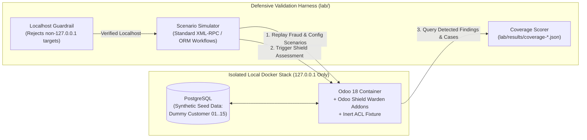

# Odoo Defensive Security & Detection Engineering Lab (`odoo-vuln-lab`)

> **Purpose:** Local-Only Adversarial Simulation, Control Validation & Detection Engineering Benchmark for Odoo 18/19  
> **Scope:** Strictly defensive research and continuous controls monitoring (CCM) verification on synthetic data.

---

## 1. Overview & Defensive Research Framing

When building security controls and fraud detection rules for an ERP system, unit tests alone are insufficient: rules that pass synthetic unit tests often fail when confronted with native ORM nuances, context-flag overrides, or multi-step insider workflows.

The **Odoo Defensive Security & Detection Engineering Lab** (`lab/`) is an isolated, local-only testbed built to benchmark and harden **Odoo Shield Warden** through structured **Plan-Do-Check-Act (Kaizen)** cycles. It replays realistic post-authentication abuse, Accounts Payable (AP) fraud workflows, and anti-forensic techniques against a disposable local Docker stack, measuring exactly which scenarios are caught, which are missed, and where architectural boundaries remain.

### Strict Safety & Ethical Guardrails
1. **Localhost-Only Enforcement:** The simulation runner (`lab/attack_lab.py`) parses the target URL at startup and **immediately terminates** if the hostname is anything other than `localhost` or `127.0.0.1`.
2. **No Software Exploits or Weaponized Payloads:** No published CVEs are exploited, and no real-world exploit steps or weaponized payloads are included. Every scenario exercises standard Odoo features (XML-RPC/JSON-RPC calls, context parameters, record rules, scheduled actions, and configuration states) that an insider or an actor holding compromised credentials could invoke.
3. **Inert Static-Analysis Fixtures:** To test the static code and ACL scanner without introducing a live exploitable route, the lab's test fixture module (`lab/vulnerable_addons/lab_vuln_portal`) intentionally contains **zero HTTP routes or executable endpoints**—only static schema/ACL misconfiguration patterns for scanner verification.
4. **Intentional Lab-Only Dummy Credentials & Synthetic Data:** All credentials and records in the lab configuration and seed scripts (`admin` / `admin`, `Winter2026!`, `Summer2026`, `Welcome1`, `demo-Passw0rd!`, PostgreSQL `odoo` / `odoo`, and `Dummy Customer 01..15`) are **deliberate, synthetic test fixtures** designed to trigger weak-credential and fraud-monitoring controls in an isolated container network. **Never deploy lab configurations or fixtures outside a local loopback environment.**

---

## 2. Lab Architecture & Kaizen Feedback Loop



---

## 3. Threat & Control Validation Catalogue (14 Scenarios)

The lab evaluates detection coverage across both high-frequency operational risks and advanced anti-forensic insider scenarios:

### 3.1 Common ERP & Accounts Payable Risk Scenarios
| ID | Scenario Simulated (Legitimate ORM/Config Mechanics) | Target Control / Detection Rule | Baseline (v1) | Post-Kaizen (v1.1) |
| :--- | :--- | :--- | :---: | :---: |
| **R1** | **Tracked Vendor IBAN Swap + Self-Trust:** Modifying `res.partner.bank` and re-trusting the account prior to payment. | `ccm_bank_change_payment`, `ccm_self_trusted_bank`, `sod_redirect_and_pay` | Detected | **Detected** |
| **R2** | **Self-Approved / Self-Paid Vendor Bill:** Same user creates, validates, and pays a vendor bill. | `ccm_self_paid_bill` | Detected | **Detected** |
| **R3** | **Duplicate Vendor Bill:** Re-entering an identical vendor bill reference/amount for a second disbursement. | `ccm_duplicate_bill` | Detected | **Detected** |
| **A6** | **API Brute-Force Throttling Disabled:** Setting `base.login_cooldown_after = 0`, removing XML-RPC/JSON-RPC login cooldowns. | `login_throttling` | Missed | **Detected** |
| **A7** | **Mass Customer Data Export:** Bulk extraction via `export_data` (where native Odoo keeps no default export log). | `mass_export` (via Shield export hook) | Missed | **Detected** |
| **A9** | **Weak Database Credentials:** Default/predictable PostgreSQL credentials permitting direct DB access. | `db_credentials` | Missed | **Detected** |
| **A10** | **Misconfigured Third-Party Addon:** Unsecured model ACLs and risky code patterns in custom addons. | `custom_module_acl`, `custom_code_risks` | Partial | **Detected** |

### 3.2 Anti-Forensic & Privileged Insider Scenarios
| ID | Scenario Simulated (Legitimate ORM/Config Mechanics) | Target Control / Detection Rule | Baseline (v1) | Post-Kaizen (v1.1) |
| :--- | :--- | :--- | :---: | :---: |
| **A1 / A1b** | **Silent IBAN Swap (`tracking_disable=True`):** Updating vendor bank coordinates with chatter tracking disabled (both pre- and post-baseline). | `ccm_untracked_bank_change` (3-layer check: chatter vs. tracking mismatch, `write_date`, and independent bank fingerprint) | Missed | **Detected** |
| **A2** | **Ghost Beneficiary (Shared Bank Account):** Assigning a vendor an IBAN/CBU that matches an internal staff-created contact's bank account. | `ccm_shared_bank_account` | Missed | **Detected** |
| **A3** | **Dormant Server Action (`ir.actions.server`):** Creating an inactive DB-stored Python action referencing privileged tokens. | `db_code_objects` | Missed | **Detected** |
| **A4** | **Auditor-Blinding Record Rule (`ir.rule`):** Adding a custom domain filter that hides specific user records from read-only roles. | `custom_record_rules` | Missed | **Detected** |
| **A5** | **Quiet Privilege Escalation (Admin Creep):** Granting administrative settings privileges to a secondary account without an audit trail. | `privilege_drift` (sealed baseline diff + recent privileged user check) | Missed | **Detected** |
| **A8** | **Non-Admin Mail Template Editor:** Granting server-side QWeb/Jinja template editing rights to a non-administrative user. | `template_editors` | Missed | **Detected** |

**Benchmark Result:** Across the Kaizen review cycles, automated detection in the lab progressed from **3/14 scenarios (v1)** to **14/14 scenarios (v1.1)**, while surfacing and fixing 6 logic bugs in the underlying controls engine.

---

## 4. Running the Lab Locally

### 1. Start the Isolated Lab Environment
Bring up the local Docker Compose stack (`dev/`) and seed the synthetic demo dataset:
```bash
cd dev
docker compose up -d

# Initialize database with Accounting and Shield
docker compose exec odoo odoo -c /etc/odoo/odoo.conf -d odoo-shield-warden -i account,odoo_shield_warden \
    --without-demo=all --stop-after-init --http-port=8090
docker compose restart odoo
```

### 2. Seed Synthetic Fraud Fixtures & Run the Detection Benchmark
From the repository root:
```bash
# Load synthetic vendor/clerk personas and baseline transactions
python tools/seed_fraud_demo.py

# Execute Wave 1 scenarios, run Shield assessment, and score detection coverage
python lab/attack_lab.py --wave 1 --label v1

# Re-score only (after modifying control logic)
python lab/attack_lab.py --score-only --label v2

# Execute Wave 2 (time-sensitive post-baseline drift & silent swap checks)
python lab/attack_lab.py --wave 2 --label v2
```

Coverage reports are written as structured JSON to `lab/results/coverage-<label>.json`.

---

## 5. Documented Detection Boundaries (Open Research)

In keeping with transparent security engineering, the lab explicitly documents scenarios where ERP-layer controls have inherent limits:
1. **Pre-Installation Exports:** Because standard Odoo does not log `export_data` calls natively, exports performed *before* Shield is installed cannot be reconstructed retroactively.
2. **Direct SQL Modifications Between Scans:** A direct PostgreSQL `UPDATE` on `res.partner.bank` bypasses the Odoo ORM and inline payment hooks at the moment of execution; Shield's independent bank fingerprint detects the tampering on the next assessment run rather than inline at the database layer.
3. **External Bank Alias Re-Pointing (`l10n_ar`):** If a banking alias is re-pointed externally at the bank without modifying the CBU/CVU stored in Odoo, the change is invisible to the ERP database.
